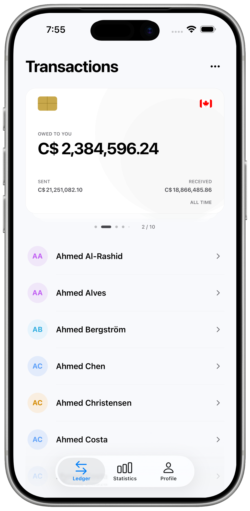
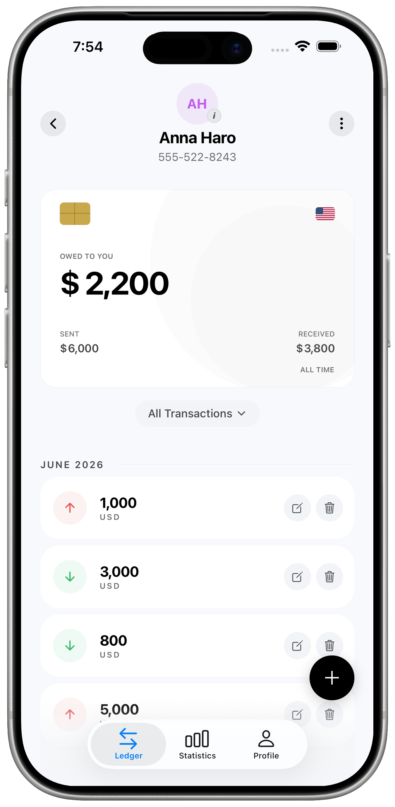
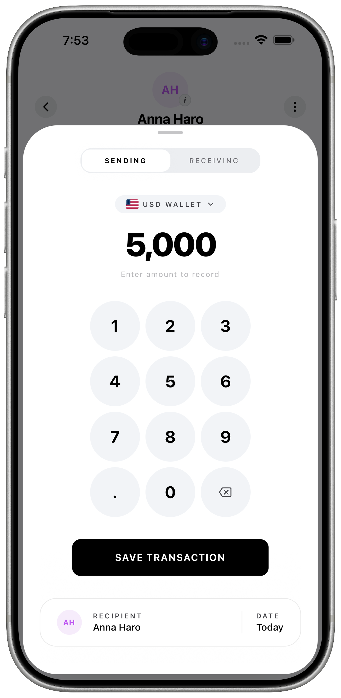
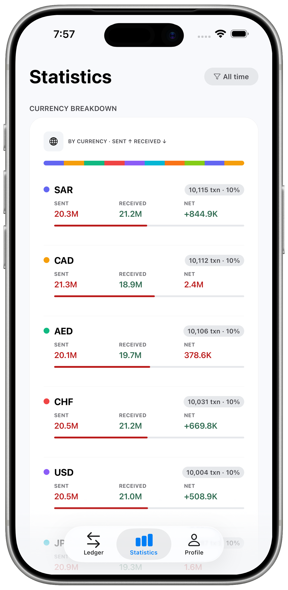
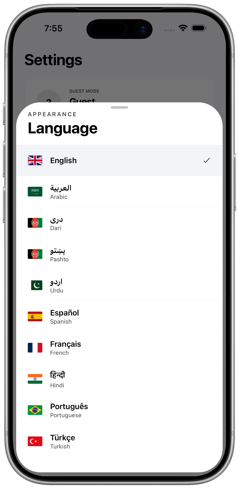

<p align="center">
  
</p>

<h1 align="center">LedgerBest</h1>

<p align="center"><em>Every person, every cent — across every currency.</em></p>

<p align="center">
  <a href="https://ledgerbest.vercel.app/en"><strong>🌐 Visit the website</strong></a>
  ·
  <a href="#download">📱 Download</a>
  ·
  <a href="#features">✨ Features</a>
</p>

---

**LedgerBest** is a privacy-first, multi-currency **personal finance & ledger app** for iOS and Android. It's built for people who lend, borrow, split, and track money with other people across currencies — freelancers, small shop owners, travelers, families, and anyone who keeps a running tab with friends or customers.

This repository contains the **marketing landing page**, built with Next.js and deployed at **[ledgerbest.vercel.app](https://ledgerbest.vercel.app/en)**.

## Download

- **App Store:** _Coming soon — currently in App Store review._ <!-- TODO: replace with App Store link once approved -->
- **Google Play:** _Coming soon._ <!-- TODO: replace with Google Play link -->

## Screenshots

| Ledger overview | Customer detail | Record a transaction |
|:---:|:---:|:---:|
|  |  |  |

| Insights & statistics | Language selection |
|:---:|:---:|
|  |  |

## Features

### 📒 Contacts & Ledgers — *Every person, every cent.*
Add a contact — or pull one from your phone book — and record unlimited transactions against them, each in any currency. Split costs, track debts, and settle balances. Currency cards show the net per currency: total received minus total sent.

### 💱 Multi-currency & Live Rates — *One world, one balance.*
Track money in **150+ currencies**. Every transaction keeps its own currency, then resolves to your home currency in real time with live exchange rates (with a manual-rate fallback). A built-in converter unifies any set of transactions into a single currency for one consolidated view.

### 📊 Insights & Trends — *See where it flows.*
Visualise transaction flow — sent vs received — across the last 6 months, by weekday, by currency, and by top contacts. Spot patterns without spreadsheets.

### And everything else

- **Export & Reports** — export any contact or month to CSV/Excel: sent, received, net balances.
- **Cloud Sync** — optional sync keeps local and cloud in step; works fully offline without it.
- **Home-Screen Widgets** — top balances, recent transactions, and cash flow at a glance.
- **Guest / Offline Mode** — start instantly, no account needed; your data lives on your device.
- **Light & Dark themes** — a consistent design system in both, with personalisable defaults.
- **Ten languages** — English, Arabic, Dari, Pashto, Urdu, Hindi, Spanish, French, Portuguese, and Turkish, with full right-to-left layout support.

## Privacy by default

LedgerBest is **offline-first**. Use it entirely on-device in guest mode, or opt into encrypted cloud sync when you want it. **No ads. No data selling.** Sign in with Apple or Google only if you choose to.

## The landing page (this repo)

A localized, theme-aware marketing site for LedgerBest:

- **Next.js (App Router) + TypeScript** with Tailwind CSS v4
- **Internationalized** with `next-intl` — English, Urdu (اردو), and Arabic (العربية), including full RTL layouts
- **Light / dark / system themes** via `next-themes`
- **SEO-ready** — sitemap, robots, Open Graph image, and JSON-LD structured data
- Subtle scroll reveals with Framer Motion

### Getting started

```bash
npm install
npm run dev
```

Open [http://localhost:3000](http://localhost:3000) — you'll be redirected to a locale route such as `/en`.

### Scripts

| Command | Description |
|---|---|
| `npm run dev` | Start the development server |
| `npm run build` | Production build |
| `npm run start` | Serve the production build |
| `npm run lint` | Run ESLint |

### Project structure

```
app/
  [locale]/        # Localized pages (en, ur, ar) + privacy policy
  components/      # Hero, feature blocks, FAQ, language & theme switchers, …
i18n/              # next-intl routing & request config
messages/          # Translations (en.json, ur.json, ar.json)
public/images/     # App screenshots & logo
```

---

<p align="center"><sub>Crafted for the minimalist curator.</sub></p>
